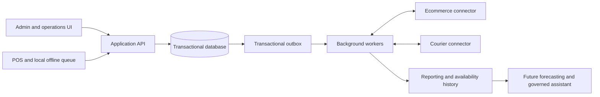

# Proposed architecture

Status: the approved stack is a TypeScript pnpm/Turborepo workspace with a NestJS API, Next.js web app and Neon PostgreSQL through Prisma. Vercel is the selected future deployment target. The domain sections below remain planning guidance until their features are reviewed and approved.

## Implemented access foundation (FEAT-002)

Better Auth runs in the API with its Prisma adapter; the browser uses HttpOnly session cookies through credentialed requests. Global identities may belong to several organizations, each mapped one-to-one to a domain tenant. Current membership and tenant status are checked server-side; the selected tenant is session state rather than a client-supplied header. The old tenant-header shortcut exists only in explicitly enabled test fixtures without credentials.

Owners and administrators require a completed TOTP or recovery-code challenge in the current session before privileged tenant operations. Invitations, member deactivation and last-owner protection use tenant-scoped transactions. Register browsers are approved for one active store; named POS grants have a fixed deadline of at most 12 hours and revalidate membership, store and device on each request. The frontend clears prior business views after identity or tenant changes and authorization failures. Independent feature QA determines delivery status in `feature-progress-list.md`.

## Structure

Start with a modular monolith and one transactional relational database. PostgreSQL is the research-backed default proposal. Run background workers for imports, integrations, notifications and analytics. Separate modules by domain boundaries before considering separate services.

## Domain modules

Tenancy/access, catalog, inventory, procurement, transfers/counts, POS/sales, returns, online orders/fulfillment, payments/COD, integrations, reporting and SaaS administration.

Shared concepts: tenant identity, location scope, money, timestamps, document identity, idempotency keys, audit events and background job status.

## Core entities

- Tenant → legal entity → brands and locations. Initially propose one legal entity per tenant; multiple entities require explicit scope approval.
- Style → colorway → size-specific variant/SKU. Collection/season are classifications; avoid forcing every product into one rigid hierarchy.
- Location → inventory balance by SKU and stock status.
- Inventory movement, reservation, receipt cost layer, stock count, adjustment and transfer.
- Supplier, purchase order/lines, goods receipt/lines and supplier return.
- Sale/order and lines, payment, shift, return/lines, exchange linkage and refund.
- External product mapping, external order mapping, fulfillment, shipment, courier settlement and integration event.

## Inventory contract

Every posted stock change creates an immutable movement. Update its balance projection in the same transaction. Corrections append reversing/compensating movements; never silently rewrite history.

Use disjoint physical buckets: sellable, quarantine and damaged. Physical on-hand is their sum. Reservations refer to sellable stock and do not alter physical quantity. Available to sell = sellable on-hand minus active reservations and any explicit safety buffer. Inbound and in-transit are separate from destination on-hand.

Persist source document/line, tenant, SKU, location, quantity, reason, actor, event time and posting time. Validate tenant ownership of every referenced entity. Serialize competing reservation/sale operations to prevent online overselling.

## Transaction boundaries

- Posting a receipt, sale, return or transfer leg commits movements, balances, relevant financial records and outbox events atomically.
- Provider calls run outside database transactions, with explicit pending/success/failure reconciliation.
- Enforce unique tenant-scoped idempotency keys and external event/order identities.
- Transfers dispatch into transit and receive out of transit; handle partial receipt, loss and discrepancies explicitly.
- Exchanges link a return and new sale with auditable difference settlement. Do not edit the original sale.

## Offline POS

Cache a versioned catalog and approved price/tax rules; persist queued sales with stable device/transaction IDs. Retries must produce one posted sale. Show last synchronization time and queued/conflicted counts.

Unrestricted offline selling and guaranteed global stock availability cannot both be promised. Decide between device stock allocations or accepted oversell risk with visible reconciliation. Resolve this before pilot checkout implementation. Gateway authorization, cross-store returns and credit redemption need explicit offline restrictions.

## Integrations

Select one ecommerce platform and one courier for release one. Define authority for catalog, price, stock and order fields. Maintain variant mappings, authenticated webhook intake, replay protection, deduplication, retries, dead-letter visibility and periodic reconciliation.

Separate order, payment and fulfillment states. Courier booking is not dispatch, delivery is not COD settlement, and courier return initiation is not stock receipt. Capture returned goods only after receipt and inspection.

## Finance and analytics

Choose one cost valuation policy before posting real stock. Snapshot sale prices, discounts, tax and cost; retain receipt dates/cost layers for aging even if weighted-average valuation is selected. Transfers must preserve stock age rather than reset it.

Capture SKU/location availability history and stockouts from day one. Start with deterministic reports; introduce a warehouse when workload warrants it. Forecasts need backtesting against simple baselines. An assistant uses approved metrics and user permissions, never unrestricted production database access.

## Security and recovery

Enforce tenant and location permissions on server operations and workers. Propose owner MFA, registered POS devices, encrypted transport, auditable sensitive actions, automated backups and tested restoration. Set measurable retention, RPO/RTO and performance objectives during discovery.
